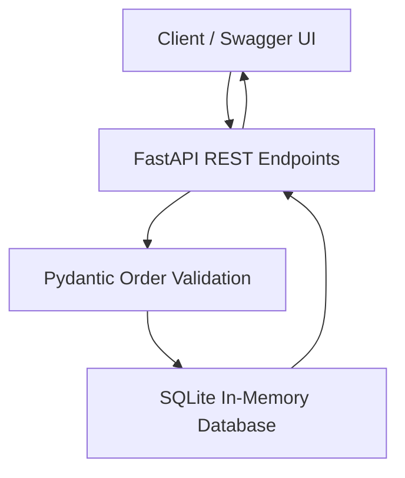

<div align="center">

# 📈 Blockhouse — Order Management API

**A lightweight REST API for creating and retrieving financial instrument orders.**


</div>

---

## 📌 Overview

Blockhouse is a Python backend project built with **FastAPI** to manage simple financial instrument order records. Users can submit an order containing a symbol, price, quantity, and order type, then retrieve the orders through REST endpoints.

The application uses **Pydantic** for request validation and **SQLite** for in-memory data storage. FastAPI also provides interactive API documentation through Swagger UI.

## ✨ Key Features

- **Create orders:** Submit order details through a REST endpoint.
- **Retrieve orders:** Fetch a list of stored orders as JSON.
- **Request validation:** Validate incoming order fields using Pydantic.
- **Interactive API documentation:** Explore and test the API using Swagger UI.
- **Docker support:** Build and run the application in a container.

## 🛠️ Tech Stack

| Component | Technology |
| --- | --- |
| Language | Python |
| API framework | FastAPI |
| Data validation | Pydantic |
| Database | SQLite (in-memory) |
| Application server | Uvicorn |
| Containerization | Docker |

## 🏗️ Architecture



**Request flow:** A client sends an order to the API → FastAPI validates the request with Pydantic → the order is stored in SQLite → the API returns a confirmation. Orders can be retrieved through `GET /orders`.

## 📦 Order Data Model

| Field | Type | Example |
| --- | --- | --- |
| `symbol` | String | `AAPL` |
| `price` | Float | `185.50` |
| `quantity` | Integer | `10` |
| `order_type` | String | `BUY` |

The project uses a single `orders` table, so no entity relationships are required for the current implementation.

## 🔌 API Endpoints

| Method | Endpoint | Description |
| --- | --- | --- |
| `POST` | `/orders` | Create a new order |
| `GET` | `/orders` | Retrieve all stored orders |
| `GET` | `/` | Return a welcome message |
| `GET` | `/docs` | Open interactive Swagger UI |

### Create an Order

**Request:**

```http
POST /orders
Content-Type: application/json
```

```json
{
  "symbol": "AAPL",
  "price": 185.50,
  "quantity": 10,
  "order_type": "BUY"
}
```

**Response:**

```json
{
  "message": "Order created successfully"
}
```

### Retrieve Orders

**Request:**

```http
GET /orders
```

**Example response:**

```json
[
  {
    "symbol": "AAPL",
    "price": 185.5,
    "quantity": 10,
    "order_type": "BUY"
  }
]
```

## 🚀 Getting Started

### Prerequisites

- Python and pip
- Docker (optional)

### Run Locally

```bash
git clone https://github.com/Sanyami-Naik/blockhouse.git
cd blockhouse
python -m venv .venv
```

Activate the virtual environment:

```bash
# macOS / Linux
source .venv/bin/activate

# Windows PowerShell (use this instead on Windows)
# .venv\Scripts\Activate.ps1
```

Install dependencies and start the API:

```bash
pip install -r requirements.txt
uvicorn app.main:app --reload
```

Open **http://127.0.0.1:8000/docs** to explore and test the endpoints.

### Run with Docker

```bash
docker build -t blockhouse-api .
docker run --rm -p 8000:8000 blockhouse-api
```

The API will be available at **http://localhost:8000/docs**.

## 📁 Project Structure

```text
blockhouse/
├── app/
│   └── main.py         # FastAPI application, order model, endpoints and SQLite logic
├── requirements.txt    # Python dependencies
└── Dockerfile          # Container configuration
```

*The structure above highlights the files used to run the API.*

---

<div align="center">

**Built to explore REST API development, request validation, and backend data handling with Python.**

</div>
